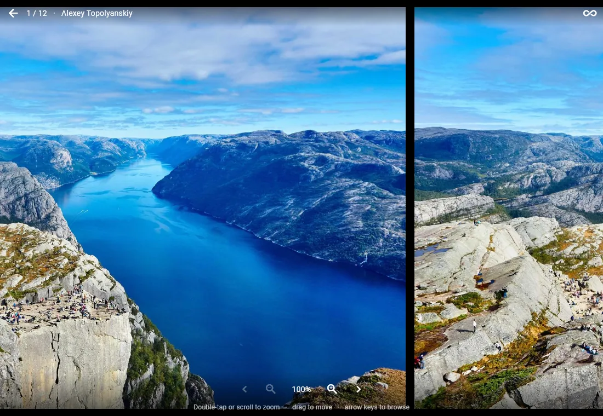

# zoomable_photo

[](https://pub.dev/packages/zoomable_photo)
[](https://github.com/atifjaveid/zoomable_photo/actions/workflows/ci.yml)
[](LICENSE)

**[Try the live demo in your browser](https://atifjaveid.github.io/zoomable_photo/)**

Zoomable photos and photo galleries for Flutter. Pinch, double-tap and mouse-wheel zoom, smooth momentum, and a gallery you can swipe through even while a photo is zoomed. No dependencies.



## Features

- **Pinch to zoom**, on touch screens and trackpads.
- **Double-tap to zoom in where you tap**, and again to zoom back out.
- **Mouse-wheel zoom where the pointer is**, for desktop and the web.
- **Drag a zoomed photo**, with momentum when you flick it. Photos never leave a gap at an edge they could cover.
- **Limits that feel right:** zooming stretches a little past the limits and springs back.
- **A gallery that works while zoomed:** dragging moves the zoomed photo, and once its edge is in view the next drag turns the page.
- **Looping galleries**, a gap between photos while swiping, and arrow-key navigation on desktop and the web.
- **Controllers** to zoom, reset and move between photos from your own buttons.
- **Any image or widget:** network, asset and file images, or any widget (such as an SVG) with `ZoomablePhoto.child`.
- Loading and error builders, Hero animations, and screen reader labels.
- **No dependencies, and no `material.dart`**: it works in Material, Cupertino and plain-widget apps, including apps using the new `material_ui` package.
- Works on Android, iOS, web, Windows, macOS and Linux.

## Getting started

```yaml
dependencies:
  zoomable_photo: ^0.1.0
```

### One photo

```dart
import 'package:zoomable_photo/zoomable_photo.dart';

ZoomablePhoto(
  image: NetworkImage('https://example.com/photo.jpg'),
)
```

The photo fills the space it's given, fitted so all of it shows. Put it in an `Expanded`, a `SizedBox` or a full-screen page.

### A gallery

```dart
PhotoGallery(
  itemCount: urls.length,
  itemBuilder: (context, index) => ZoomablePhoto(
    image: NetworkImage(urls[index]),
  ),
)
```

Options:

- `loop: true` goes from the last photo back to the first, and the other way.
- `pageSpacing` is the gap between photos while swiping (16 by default).
- `scrollDirection: Axis.vertical` stacks photos vertically.
- `onPageChanged` tells you which photo is showing.

### Zoom options

```dart
ZoomablePhoto(
  image: AssetImage('assets/map.png'),
  fit: BoxFit.cover,     // Fill the view instead of showing it all.
  minScale: 1,           // 1 is the fitted photo.
  maxScale: 6,
  doubleTapScale: 3,     // Null turns double-tap zoom off.
  onTap: toggleControls, // A single tap, for example to hide your controls.
  heroTag: photo.id,     // Animate from a thumbnail with the same Hero tag.
  semanticLabel: 'Sunset over the harbour',
  loadingBuilder: (context, progress) =>
      const Center(child: CircularProgressIndicator()),
  errorBuilder: (context, error, stackTrace) =>
      const Center(child: Text("Couldn't load this photo")),
)
```

### Controllers

```dart
final zoom = ZoomablePhotoController();      // Dispose these in your
final gallery = PhotoGalleryController();    // State's dispose().

ZoomablePhoto(image: image, controller: zoom)
PhotoGallery(controller: gallery, itemCount: 10, itemBuilder: ...)

zoom.zoomTo(2);          // Animated; pass animate: false to jump.
zoom.zoomIn();
zoom.reset();
print(zoom.scale);       // 1 is the fitted photo.
print(zoom.isZoomed);

gallery.next();
gallery.previous();
gallery.animateTo(3);
print(gallery.index);
```

Both controllers notify their listeners when something changes, so you can rebuild your own buttons with `ListenableBuilder`.

### Zooming other widgets

```dart
ZoomablePhoto.child(
  childSize: const Size(1200, 800), // The size it's laid out at.
  child: SvgPicture.asset('assets/floor_plan.svg'),
)
```

## Moving from photo_view

[photo_view](https://pub.dev/packages/photo_view) hasn't had a release since April 2024. Most of its options have a direct equivalent here:

| photo_view | zoomable_photo |
|---|---|
| `PhotoView(imageProvider: ...)` | `ZoomablePhoto(image: ...)` |
| `PhotoView.customChild(child: ..., childSize: ...)` | `ZoomablePhoto.child(child: ..., childSize: ...)` |
| `PhotoViewGallery.builder(itemCount:, builder:)` | `PhotoGallery(itemCount:, itemBuilder:)`, with a `ZoomablePhoto` as each page |
| `minScale: PhotoViewComputedScale.contained` | `minScale: 1` (the default) |
| `maxScale: PhotoViewComputedScale.contained * 4` | `maxScale: 4` (scales are multiples of the fitted size) |
| `heroAttributes: PhotoViewHeroAttributes(tag: id)` | `heroTag: id` |
| `loadingBuilder`, `errorBuilder`, `semanticLabel` | The same names |
| `backgroundDecoration` | Wrap it in a `ColoredBox` or `DecoratedBox` |
| `onTapUp` | `onTap` |
| `controller` / `scaleStateController` | `controller` (a `ZoomablePhotoController`) |
| `pageController` | `controller` (a `PhotoGalleryController`) |

Not supported yet: rotation and custom scale-state cycles.

## Example

The [example app](example) is a photo grid that opens a full-screen gallery with zoom buttons, a page counter and a loop switch. [Try it in your browser](https://atifjaveid.github.io/zoomable_photo/), or run it:

```sh
cd example
flutter run
```

## Roadmap

- Swipe down to close a full-screen gallery.
- Rotation.
- A strip of thumbnails for galleries.

Issues and pull requests are welcome.
